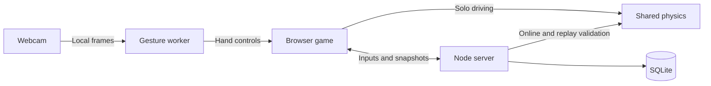

<div align="center">

# VELOCITY

### Your hands. Your machine. Your racing line.

<p>
  <a href="https://velocity.kevindemara.com/">
    
  </a>
</p>

**[Play Single Player Demo →](https://velocity.kevindemara.com/)**

Race AI opponents in your browser. No install. Webcam optional.

A browser arcade racer with real 3D cars, calibrated webcam steering, and online multiplayer.


[Get started](#get-on-the-grid) · [Controls](#controls) · [Webcam](#drive-with-your-hands) · [Tech stack](#under-the-hood)


</div>

Pick a car, tune its handling, and chase the next corner. Race three AI rivals, improve your best lap against a saved ghost, or invite friends to a private grid. Drive with a keyboard, controller, touch controls, or your own hand movements.

**A webcam is optional.** You can play the entire game without one.

**Two editions, one game:** the Full Edition includes online racing and server-verified records. The **Solo Edition** keeps all eleven cars, four worlds, six local events, AI opponents, customization, controls, graphics and local progression, and runs entirely as static files. See [Shared hosting / Namecheap deployment](#shared-hosting--namecheap-deployment).

## What makes it Velocity?

- **A garage with character:** eleven distinct machines, paint and stripes, wheel unlocks, boost trails, and setup comparisons based on the driving physics.
- **Four worlds to learn:** coastal sweepers, neon city streets, desert straights, and alpine climbs.
- **More than the finish line:** nitro pickups, controlled drifts, near misses, rough shoulders, oil, barriers, and a signed fast lane.
- **Useful race feedback:** live standings, lap splits, upcoming turns, obstacle distance, ghost gaps, and a minimap.
- **A view that suits you:** Chase, Wide, and first-person Road cameras; adjustable graphics, reduced motion/flashes, and a high-contrast HUD.
- **Progress worth keeping:** XP, achievements, recent races, personal bests, saved settings, and complete ghost replays.

## A look around

| Choose your machine | Race after dark |
|:---:|:---:|
|  |  |
| Compare speed, acceleration, grip, and durability before joining the grid. | Warm lamps, reflective puddles, neon curbs, and city skylines. |

Screenshots are captured from the playable game. Cars and scenery are procedural Three.js meshes; the asphalt uses a generated texture.

## Get on the grid

Use **Node.js 22.13+**; **Node 24** is recommended.

```sh
git clone https://github.com/kevindemara/hand-racer-velocity.git
cd hand-racer-velocity
npm ci
npm run build:worker
npm start
```

Open **[localhost:3000](http://localhost:3000/)**.

1. Choose your car, course, difficulty, event, and distance.
2. Try **Rookie + Nova RS + Corner grip** for a forgiving first run.
3. Select **Start single player**, or take the practice run to learn acceleration, steering, braking, and nitro.

Development uses Vite middleware. Refresh the page after client edits; restart the server after changing shared physics or server code.

<details>
<summary>Use another port</summary>

PowerShell:

```powershell
$env:PORT = '3001'
npm start
```

macOS / Linux:

```sh
PORT=3001 npm start
```

Then open `http://localhost:3001`.

</details>

## Controls

| Action | Keyboard | Webcam | Standard gamepad |
|---|---|---|---|
| Accelerate | **W / ↑** | Close your fist | Right trigger / A |
| Brake | **Space / S / ↓** | Open your palm | Left trigger / B |
| Steer | **A / D / ← / →** | Tilt your calibrated hand | Left stick |
| Nitro | **Left Shift** | Keyboard or touch | Left bumper |
| Drift | **X** | Keyboard or touch | Right bumper |
| Pause | **Escape** or the Pause button | Pause button | Pause button |

Hold the on-screen buttons on phones and tablets. Remap keyboard bindings and adjust controller dead zones in **Settings**. Nonstandard gamepad layouts can differ.

You can mix inputs: manual steering keeps your hand pedals, while manual pedals keep your hand steering. Manual braking overrides hand acceleration. Steering becomes gentler at racing speed without losing low-speed maneuverability.

**Find your rhythm:** use nitro on straights, keep clear of oil and barriers, and look for the fast-lane signs. Nitro recharges over time; green pads, near misses, and controlled drifts replenish it faster.

## Drive with your hands

1. Enable **Use webcam controls** in the garage, or **Enable webcam** during a race.
2. Allow camera access. Hold one open palm steady, facing the camera, until the calibration progress completes.
3. Close your fist to accelerate, open your palm to brake, and tilt your hand to steer.

The preview shows detected landmarks, gesture confidence, and steering. If your hand is visible but calibration stays low, select **Use current hand position** to capture a fresh neutral angle. Use **Recalibrate** after moving the camera or switching hands.

**Your camera frames stay local.** MediaPipe runs in a browser worker; frames are not uploaded to the game server. Keyboard, touch, and controller controls remain available. **Use keyboard** explicitly turns the webcam off, and **Retry camera** restarts setup after a device or permission issue.

Solo hand-loss recovery can pause the run; online recovery holds the brakes while the shared race continues. Switching away also pauses solo racing or enters online brake hold. Returning waits for **Resume** and fresh camera setup when needed.

Use even lighting and keep your fingers visible. Camera access works on localhost; remote play with webcam controls requires HTTPS. Recognition varies with the camera and lighting.

## Pick your event

| Event | The challenge |
|---|---|
| **Circuit race** | Beat three AI drivers over 1, 3, 5, or 30 laps. |
| **Time trial** | Chase your saved best ghost for the same course, car, and setup. |
| **Elimination** | The last active driver is removed whenever the leader completes another lap. |
| **Survival** | Keep moving above roughly 43 km/h for 90 seconds. Three hits, or more than 12 accumulated seconds below that speed, ends the run. |
| **Checkpoint rush** | Start with 12 seconds. Gates add 4 seconds, with at most 15 seconds of time ahead. |
| **Championship** | Coast → Mesa → Alpine → City. Earn 36 points across four rounds to claim a title. |

**Rookie, Club, and Pro** change opponent pace, obstacle density, and steering assistance. **Daily course** uses the same UTC-date seed for everyone. Practice runs leave records and XP untouched.

## Eleven machines, four worlds

| Machine | Character |
|---|---|
| **Apex GT** | Balanced grand touring coupe |
| **Nova RS** | Quick, forgiving rally hatch |
| **Vanta XR** | Powerful muscle car with a loose rear end |
| **Ion E** | Electric torque and a planted stance |
| **Trail RX** | Durable truck built for rough ground |
| **Stratos R** | Lightweight, fast prototype |
| **Solstice S** | Agile open-top roadster |
| **Caldera SP** | Wide, fast supercar |
| **Tempo 86** | Dependable classic sport coupe |
| **Nomad BX** | Big-tire dune buggy |
| **Vector F1** | Precise open-wheel speed with fragile bodywork |

The garage shows setup-adjusted top speed, measured dry-road 0–100 km/h acceleration without nitro, grip, and durability relative to the Apex GT. **Corner grip** trades some speed for grip; **Top speed** does the reverse.

| Course | The setting |
|---|---|
| **Golden Coast** | Ocean views, palms, and long sweeping turns |
| **Midnight District** | Neon streets, lamps, and puddle highlights |
| **Red Mesa** | Sandstone, dust, and fast straights |
| **Alpine Run** | Snowy summits, pine trees, elevation, and tight bends |

## Bring your crew

**Quick match** starts when two compatible drivers join. **Private room** supports **2–4 drivers**: share the room code or invite link, have everyone mark Ready, then let the host start the race. All drivers vote for an online rematch.

The server owns online physics, hazards, countdowns, and finishing times. Brief disconnects have a **20-second** recovery window; the garage offers rejoin after reload. A friend's invite must use a host address they can reach—`localhost` on their computer is not your computer.

Circuit, time-trial, and championship leaderboards accept server-verified solo replays; online results come from the server simulation. Turning off steering assistance keeps solo results local. Other event scores and practice use local results. The prototype has no authenticated accounts or competitive anti-bot guarantees.

## Under the hood

| Layer | Technology | What it does |
|---|---|---|
| Rendering | **Three.js 0.186.1 / WebGL** | Procedural cars and scenery, lighting, shadows, particles, and bloom |
| Hand tracking | **MediaPipe Tasks Vision 1.1.0** | Local gesture recognition, palm calibration, and handedness filtering |
| Client | **JavaScript ES modules, HTML, CSS** | Garage, race HUD, controls, profiles, and responsive layouts |
| Build / development | **Vite 8.3.4** | Development middleware, production bundles, and the classic gesture-worker build |
| Server | **Node.js + Express 5.2.1** | Serves the game, local model assets, and leaderboard APIs |
| Multiplayer | **Socket.IO 4.8.4** | Rooms, ready checks, reconnects, 20 Hz inputs and snapshots |
| Persistence | **SQLite through `node:sqlite`** | Verified records and skill ratings |
| Local saves | **Browser localStorage** | Settings, customization, XP, history, personal bests, and compressed ghosts |
| Sound | **Web Audio API** | Engine, tire, countdown, collision, and pickup feedback |
| Verification | **Node's built-in test runner** | Physics, gestures, controls, rendering lifecycle, persistence, and networking |

Solo driving, multiplayer, and replay verification share the same **60 Hz physics**. Webcam inference runs at up to **25 Hz**, with one frame in flight. Rendering interpolates online opponents between snapshots.



## Development and checks

```sh
npm run build    # Production client and gesture worker
npm test         # Gameplay, webcam, profiles and multiplayer regressions
npm audit        # Dependency audit
```

`/diagnostics.html` checks local model inference without requesting a webcam, cycles graphics resources through the four environments, and previews road markings.

| Path | Purpose |
|---|---|
| `public/src/` | Rendering, UI, input, webcam, audio, and local profiles |
| `shared/` | Physics, gesture filtering, and event rules |
| `server/` | HTTP APIs, online races, and SQLite persistence |
| `public/assets/` | Textures, local gesture model, and screenshots |
| `public/vendor/` | MediaPipe WASM runtime and built gesture worker |
| `tests/` | Regression and integration coverage |

For production, run `npm run build`, set `NODE_ENV=production`, then run `npm start`. The included `render.yaml` uses this workflow. `PORT` selects the listening port; `RACING_DB` can point SQLite at durable storage. The default database is `server/data/racing.sqlite`. Ephemeral hosting storage can lose records on redeploy.

Profiles and ghosts belong to the browser they were saved in. A blocked or full browser store still allows racing, but can limit persistence. No paid services or external car-model downloads are required.

## Shared hosting / Namecheap deployment

The Solo Edition is a static website for Apache-compatible shared hosting. **Upload only the compiled Solo files, never the repository, `server/`, `node_modules/`, or a database.** No Node process, Passenger application, PHP, external API, WebSocket service or database is required on the host. Node is used only on your own computer to build and test.

### Build and preview locally

Use Node.js **22.13 or newer** (Node 24 recommended), with npm:

```sh
npm ci
npm test
npm run build           # Full Edition; existing server deployment remains supported
npm run test:solo       # Builds Solo and tests the compiled static output over HTTP
npm run package:solo    # Builds Solo again and creates the validated deployment ZIP
npm run preview:solo    # Local static preview at http://localhost:4173/
```

Stop the preview with Ctrl+C. If 4173 is occupied, set `SOLO_PORT` before starting the preview. Do not open `index.html` with `file://`; workers and browser modules need HTTP locally or HTTPS on the deployed site.

| Command / output | Purpose |
|---|---|
| `npm run build` → `dist/` | Full frontend; `npm start` still runs the original Express/Socket.IO/SQLite application |
| `npm run build:solo` → `dist-namecheap/` | Complete static Solo website |
| `npm run package:solo` → `velocity-namecheap-solo.zip` | ZIP with `index.html`, assets, worker, WASM and `.htaccess` directly at its root |
| `npm run preview:solo` | Development-only static HTTP server; never uploaded |

The default Solo base is `/`, for a dedicated subdomain such as `https://velocity.example.com/`. **That address is an example, not a configured domain.** The generated directories and ZIP are ignored by Git. Build scripts copy an explicit runtime asset allowlist instead of copying the repository; packaging rejects unexpected files and backend/development references.

### Optional subdirectory installation

For `https://example.com/velocity/`, build with `/velocity/` as the base, including both slashes. In PowerShell:

```powershell
$env:VELOCITY_BASE = '/velocity/'
npm run test:solo
npm run package:solo
npm run preview:solo
```

The preview opens at `http://localhost:4173/velocity/`. Upload this ZIP's contents into the corresponding `velocity` directory. On macOS/Linux prefix each command with `VELOCITY_BASE=/velocity/`. Nested paths such as `/games/velocity/` are also accepted; external URLs and traversal paths are rejected.

To return to a dedicated subdomain root in PowerShell, run `$env:VELOCITY_BASE = '/'` and regenerate the package. Each build replaces `dist-namecheap/`; keep separately named copies if you need both deployment paths. A package built for `/velocity/` will not work at `/` without rebuilding.

### Create the cPanel destination

1. Sign in to your hosting cPanel and open **Domains → Create A New Domain**.
2. Enter your intended subdomain, for example `velocity.your-domain.com`.
3. Disable **Share document root** and choose a separate directory for this game. Note the exact document root shown by cPanel. Create the domain. Existing account configuration can affect the available fields; follow [Namecheap's current subdomain guide](https://www.namecheap.com/support/knowledgebase/article.aspx/9190/29/how-to-create-a-subdomain-in-cpanel/).
4. In **File Manager**, open that exact document root. Enable **Show Hidden Files** so `.htaccess` is visible.
5. Upload `velocity-namecheap-solo.zip` into this directory, then choose **Extract** into the same directory. Confirm that `index.html`, `assets/`, `vendor/`, `build-info.json` and `.htaccess` are directly there, with no enclosing `dist-namecheap` folder. You can remove the uploaded ZIP afterward.
6. Verify a valid SSL certificate covers the subdomain using cPanel's **Namecheap SSL** tools, then open the game with `https://`. Certificate availability and renewal depend on your account. See [Namecheap's SSL manager guide](https://www.namecheap.com/support/knowledgebase/article.aspx/9387/2218/what-is-namecheap-ssl-and-how-do-i-use-it/). Camera access requires HTTPS outside localhost. Enable HTTPS redirection through the hosting controls after HTTPS works.

The included `.htaccess` sets the directory index, JavaScript/WASM MIME types, and conservative cache revalidation. It contains no PHP handlers, proxy rules, SPA rewrites or forced redirects. Keep this file scoped to the game's own directory; do not replace an unrelated site's `.htaccess`.

**If Cloudflare manages your DNS:** add an A record for the game subdomain using the shared IP shown in your own cPanel account. Leave the existing apex, `www`, email records and nameservers as they are. DNS-only works with a valid hosting certificate and lets the hosting provider validate the origin directly while SSL is being issued.

Namecheap may reject a standalone subdomain as an addon domain with a remote-nameserver/ownership error. In that case, first add the parent domain to cPanel with its own separate document root, then add the game as a subdomain of that parent. This creates hosting definitions; it does not require changing the parent website's authoritative DNS. If cPanel requests a verification TXT record, use the exact name/value displayed by cPanel; never copy another account's validation token. Check that subdomain creation succeeded before waiting for its certificate. Namecheap's automatic SSL installation can take time after the domain becomes reachable. Keep browser certificate validation enabled and wait for valid HTTPS before enabling webcam controls or forcing HTTPS redirects. Do not lower the entire Cloudflare zone's SSL/security settings to make the game load.

**Cloudflare Origin CA alternative:** generate the private key and public CSR on the hosting server, issue an Origin CA certificate for only the game hostname, and install it in cPanel with the matching key and Cloudflare RSA root chain. Keep the private key outside every web root and repository. Enable Cloudflare proxying for that game's A record and apply **SSL: Strict** through a hostname-specific Page Rule when other sites share the zone. Verify HTTPS first, then add an HTTP-to-HTTPS redirect scoped to the game's directory. Origin CA certificates require the Cloudflare proxy to remain enabled; browsers do not trust them when connecting directly to the origin. See [Cloudflare's Origin CA instructions](https://developers.cloudflare.com/ssl/origin-configuration/origin-ca/).

The live [Velocity Solo installation](https://velocity.kevindemara.com/) uses this Origin CA setup, a hostname-specific Strict rule, and an HTTPS redirect. Its origin certificate expires **October 19, 2041 UTC**. Track that date when maintaining the site; Cloudflare does not send Origin CA expiry notifications. The downloadable ZIP stays portable and does not include deployment-specific redirects or any certificates/keys. Preserve the live redirect when replacing its `.htaccess` during an update.

### Test the uploaded game

1. Open the HTTPS URL. The menu should say **SOLO EDITION / 3D**, with **Your records** and no Quick Match, private room, room code or invite controls.
2. In browser developer tools, inspect **Console** and **Network**. Required JS/CSS, the asphalt texture and favicon must load successfully. There should be no `/api/`, Socket.IO, WebSocket, Vite development or localhost requests.
3. Choose a car, track and difficulty; complete a circuit race against AI. Use **Race again**, return to the garage, then open **Your records**. Reload and confirm the record and settings remain.
4. Try the other events and graphics settings. Complete a **Time trial** and run the same track, difficulty, distance, daily seed, car and setup again to see its saved ghost. Ghost categories intentionally distinguish these settings.
5. Enable webcam controls, allow access, and wait for calibration. Confirm the preview, fist acceleration, palm braking and tilted steering. The first webcam start downloads the local model and WASM; no camera frame is uploaded. Cover/uncover your hand and check recovery. Turn the camera off and confirm keyboard play still works.
6. Repeat with camera access denied: driving with keyboard/touch/controller must remain available. Test your physical controller and phone/tablet if you use them; desktop emulation cannot verify real device behavior.

Local records are personal bests for a course/event/difficulty/distance/seed, compared across cars and setups. They are stored on this browser, not globally ranked, synchronized or server-verified. Progression and recent attempts remain in the Driver log. Blocked/full browser storage leaves gameplay working and displays a save warning. Different domains, browser profiles or ports have separate saves; clearing site data removes them. Full and Solo installations on the same origin intentionally reuse the existing profile format.

Once the game and needed assets are loaded, local simulation does not need a backend or connection. **Offline reloads are not guaranteed:** there is no mandatory service worker/PWA cache. Enable the webcam while online before testing camera use offline, since its resources load on demand.

### Publish future updates

Keep editing the shared source, run the tests and regenerate the ZIP with the correct base. Back up the game's current hosting directory, upload the new ZIP and extract it into that same game directory. Upload assets/vendor files before switching `index.html` if updating manually. Do not delete unrelated hosting files, `.well-known` certificate files or other websites. Keep old hashed assets until open game sessions have closed; remove only files you know belong to an older Solo build.

The generated `.htaccess` asks browsers to revalidate files; Vite also hashes the main JS/CSS filenames. If a hosting cache/CDN is enabled, purge the game path after updating and hard-refresh. Do not clear browser storage to refresh code, because that deletes racing progress. Model/worker/vendor filenames are stable and must be replaced together with each release.

### Troubleshooting

| Symptom | Check |
|---|---|
| Blank screen | Confirm HTTPS, the document root, and the Console's first error. Use a modern WebGL-capable browser with hardware acceleration. |
| JS/CSS/texture 404 | Check extraction depth and the build base. Rebuild for the URL where the game is actually installed. |
| Missing model / worker | Upload all of `assets/models/` and `vendor/`, not just the Vite `assets` bundle. Files must come from the same package. |
| WASM MIME or compilation error | Confirm `.wasm` requests return actual binary with `application/wasm`, not an HTML error page, access restriction or inherited rewrite response. Verify the scoped `.htaccess` was extracted. |
| Camera fails | Use HTTPS, allow the correct site's permission, close other apps using the camera, then Retry camera. Declining access does not prevent keyboard racing. |
| Progress disappears | Check private browsing, blocked/full localStorage, changed hostname/port/profile, or deleted site data. Saves are browser-local. |
| New HTML but old JavaScript | Upload the complete new package, purge host/CDN caches if enabled and hard-refresh; keep site data. |
| Server error after extraction | Check inherited hosting rules and the scoped `.htaccess`. Consult host support if an Apache directive is restricted; the game needs no rewrite rules or security-policy relaxations. |

### Shared implementation and verification

Both editions use the same `main.js`, renderer, physics, AI, input, webcam, audio, profiles, ghosts and event rules. `vite.solo.config.js` sets a compile-time Solo flag, strips marked online-only HTML and replaces the networking adapter. Online challenge/record requests and invite/session handlers are excluded from Solo execution; Socket.IO is absent from the Solo bundle. A small local-records view uses existing profile bests/ghosts. Shared asset URLs respect Vite's configured base, including the classic worker's model/WASM paths. `server/server.js`, shared physics and `render.yaml` remain the Full Edition implementation.

New build tools: `scripts/build-solo.mjs`, `scripts/package-solo.mjs`, `scripts/solo-artifacts.mjs` and the local-only `scripts/serve-solo.mjs`. New regression coverage lives in `tests/solo-records.test.mjs`, `tests/static/` and the existing application integration fixture. The static worker probe is a test fixture only and is excluded from the deployment ZIP.

Verification for the initial static edition (October 21, 2026):

| Check | Result |
|---|---|
| Lockfile installation (`npm ci`) | Passed; 110 packages installed, dependency audit reported zero vulnerabilities |
| `npm test` | 140 passed, 0 failed; includes server replay verification, multiplayer recovery, four-driver private lobbies, host transfer, gestures, inputs, profiles and all-car physics |
| `npm run build` | Passed; Full frontend and diagnostics built successfully |
| `npm run test:solo`, `/` and `/velocity/` | 3 passed, 0 failed at each base; all static asset bytes and WASM MIME checked over HTTP; nonexistent APIs/source files return 404 |
| `npm run package:solo` | Passed; 16 static files, about 21.55 MiB compressed; `index.html` at ZIP root; no backend, databases, source maps or dependency directories |
| Independent ZIP extraction | .NET ZIP reader extracted all entries; SHA256 hashes matched the generated deployment files |
| Desktop browser, Solo | Circuit finished against three AI drivers (26.87 s), Race again, garage navigation, personal record/ghost retained after reload |
| Time trial / ghost replay | Trial finished (22.58 s); next run displayed the saved ghost and a live 0.29 s gap |
| Static webcam resources | Extracted root ZIP and nested build both loaded local worker/WASM/model and completed blank-frame inference without requesting a webcam |
| Mobile emulation | 390 × 844 layout exposed touch controls; held GO accelerated to 206 km/h in Checkpoint rush |
| Settings and network | Graphics/view/reduced-motion settings survived reload; inspected Solo requests stayed on the static origin with no APIs, Socket.IO, WebSockets or Vite client |
| Full production runtime | Original command served the game, health, challenge and leaderboard endpoints; browser created a private Socket.IO lobby successfully; used a separate test SQLite database |

No test failures remain. Browser graphics logs contained an existing ANGLE shader precision warning; rendering and racing continued. A temporary worker-only test fixture initially requested a missing default favicon; the deployed game uses its bundled icon, and the fixture now disables that request. **Not executed:** a real live-hand calibration/accuracy session, physical gamepad, real phone/tablet, Safari/Firefox, actual Namecheap Apache/SSL deployment, or a network-disconnected reload. Camera-denied/error recovery and controller logic are regression-tested with mocks, not physical hardware. Follow the manual checklist above on your own HTTPS host. No hosting, DNS, push or merge was performed.

**Deployment checklist:** build and test → generate the root or subdirectory ZIP → create a separate HTTPS document root → upload and extract the ZIP contents there → confirm `index.html` placement → test a race, saved records and webcam permissions. No live hosting or DNS changes are performed by the build tools.

---

<div align="center">

**Built by Kevin DeMara / Eventide Studios** · MIT licensed

*Pick your machine. Find your line.*

</div>
