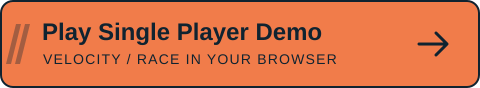
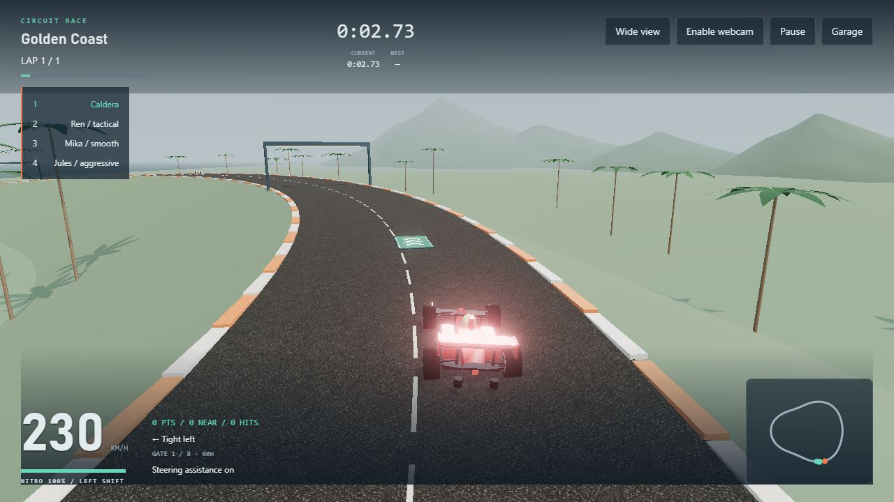
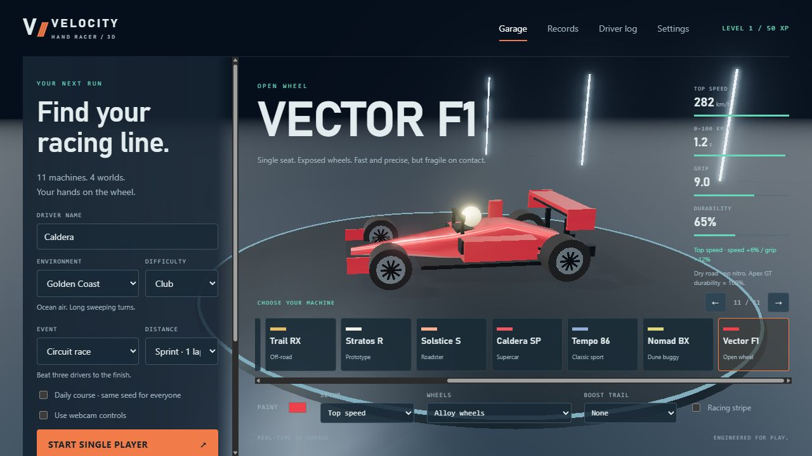
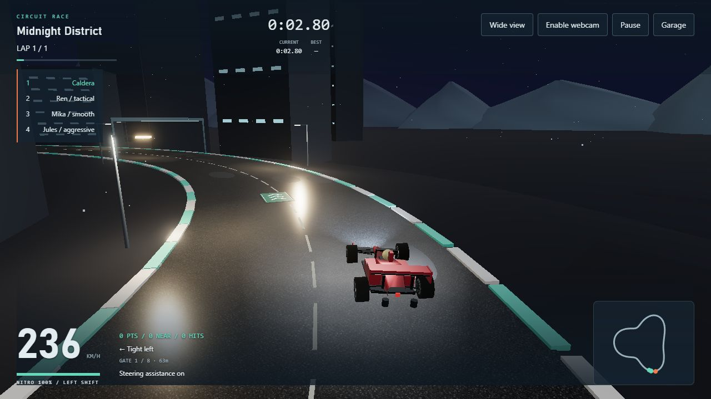
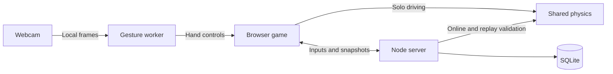

<div align="center">

# VELOCITY

### Your hands. Your machine. Your racing line.

<p>
  <a href="https://velocity.kevindemara.com/">
    
  </a>
</p>

**[Play Single Player Demo →](https://velocity.kevindemara.com/)**

Race AI opponents in your browser. No install. Webcam optional.

A browser arcade racer with real 3D cars, calibrated webcam steering, and online multiplayer.


[Get started](#get-on-the-grid) · [Controls](#controls) · [Webcam](#drive-with-your-hands) · [Tech stack](#under-the-hood)



</div>

Pick a car, tune its handling, and chase the next corner. Race three AI rivals, improve your best lap against a saved ghost, or invite friends to a private grid. Drive with a keyboard, controller, touch controls, or your own hand movements.

**A webcam is optional.** You can play the entire game without one.

## What makes it Velocity?

- **A garage with character:** eleven distinct machines, paint and stripes, wheel unlocks, boost trails, and setup comparisons based on the driving physics.
- **Four worlds to learn:** coastal sweepers, neon city streets, desert straights, and alpine climbs.
- **More than the finish line:** nitro pickups, controlled drifts, near misses, rough shoulders, oil, barriers, and a signed fast lane.
- **Useful race feedback:** live standings, lap splits, upcoming turns, obstacle distance, ghost gaps, and a minimap.
- **A view that suits you:** Chase, Wide, and first-person Road cameras; adjustable graphics, reduced motion/flashes, and a high-contrast HUD.
- **Progress worth keeping:** XP, achievements, recent races, personal bests, saved settings, and complete ghost replays.

## A look around

| Choose your machine | Race after dark |
|:---:|:---:|
|  |  |
| Compare speed, acceleration, grip, and durability before joining the grid. | Warm lamps, reflective puddles, neon curbs, and city skylines. |

Screenshots are captured from the playable game. Cars and scenery are procedural Three.js meshes; the asphalt uses a generated texture.

## Get on the grid

Use **Node.js 22.13+**; **Node 24** is recommended.

```sh
git clone https://github.com/kevindemara/hand-racer-velocity.git
cd hand-racer-velocity
npm ci
npm run build:worker
npm start
```

Open **[localhost:3000](http://localhost:3000/)**.

1. Choose your car, course, difficulty, event, and distance.
2. Try **Rookie + Nova RS + Corner grip** for a forgiving first run.
3. Select **Start single player**, or take the practice run to learn acceleration, steering, braking, and nitro.

Development uses Vite middleware. Refresh the page after client edits; restart the server after changing shared physics or server code.

<details>
<summary>Use another port</summary>

PowerShell:

```powershell
$env:PORT = '3001'
npm start
```

macOS / Linux:

```sh
PORT=3001 npm start
```

Then open `http://localhost:3001`.

</details>

## Controls

| Action | Keyboard | Webcam | Standard gamepad |
|---|---|---|---|
| Accelerate | **W / ↑** | Close your fist | Right trigger / A |
| Brake | **Space / S / ↓** | Open your palm | Left trigger / B |
| Steer | **A / D / ← / →** | Tilt your calibrated hand | Left stick |
| Nitro | **Left Shift** | Keyboard or touch | Left bumper |
| Drift | **X** | Keyboard or touch | Right bumper |
| Pause | **Escape** or the Pause button | Pause button | Pause button |

Hold the on-screen buttons on phones and tablets. Remap keyboard bindings and adjust controller dead zones in **Settings**. Nonstandard gamepad layouts can differ.

You can mix inputs: manual steering keeps your hand pedals, while manual pedals keep your hand steering. Manual braking overrides hand acceleration. Steering becomes gentler at racing speed without losing low-speed maneuverability.

**Find your rhythm:** use nitro on straights, keep clear of oil and barriers, and look for the fast-lane signs. Nitro recharges over time; green pads, near misses, and controlled drifts replenish it faster.

## Drive with your hands

1. Enable **Use webcam controls** in the garage, or **Enable webcam** during a race.
2. Allow camera access. Hold one open palm steady, facing the camera, until the calibration progress completes.
3. Close your fist to accelerate, open your palm to brake, and tilt your hand to steer.

The preview shows detected landmarks, gesture confidence, and steering. If your hand is visible but calibration stays low, select **Use current hand position** to capture a fresh neutral angle. Use **Recalibrate** after moving the camera or switching hands.

**Your camera frames stay local.** MediaPipe runs in a browser worker; frames are not uploaded to the game server. Keyboard, touch, and controller controls remain available. **Use keyboard** explicitly turns the webcam off, and **Retry camera** restarts setup after a device or permission issue.

Solo hand-loss recovery can pause the run; online recovery holds the brakes while the shared race continues. Switching away also pauses solo racing or enters online brake hold. Returning waits for **Resume** and fresh camera setup when needed.

Use even lighting and keep your fingers visible. Camera access works on localhost; remote play with webcam controls requires HTTPS. Recognition varies with the camera and lighting.

## Pick your event

| Event | The challenge |
|---|---|
| **Circuit race** | Beat three AI drivers over 1, 3, 5, or 30 laps. |
| **Time trial** | Chase your saved best ghost for the same course, car, and setup. |
| **Elimination** | The last active driver is removed whenever the leader completes another lap. |
| **Survival** | Keep moving above roughly 43 km/h for 90 seconds. Three hits, or more than 12 accumulated seconds below that speed, ends the run. |
| **Checkpoint rush** | Start with 12 seconds. Gates add 4 seconds, with at most 15 seconds of time ahead. |
| **Championship** | Coast → Mesa → Alpine → City. Earn 36 points across four rounds to claim a title. |

**Rookie, Club, and Pro** change opponent pace, obstacle density, and steering assistance. **Daily course** uses the same UTC-date seed for everyone. Practice runs leave records and XP untouched.

## Eleven machines, four worlds

| Machine | Character |
|---|---|
| **Apex GT** | Balanced grand touring coupe |
| **Nova RS** | Quick, forgiving rally hatch |
| **Vanta XR** | Powerful muscle car with a loose rear end |
| **Ion E** | Electric torque and a planted stance |
| **Trail RX** | Durable truck built for rough ground |
| **Stratos R** | Lightweight, fast prototype |
| **Solstice S** | Agile open-top roadster |
| **Caldera SP** | Wide, fast supercar |
| **Tempo 86** | Dependable classic sport coupe |
| **Nomad BX** | Big-tire dune buggy |
| **Vector F1** | Precise open-wheel speed with fragile bodywork |

The garage shows setup-adjusted top speed, measured dry-road 0–100 km/h acceleration without nitro, grip, and durability relative to the Apex GT. **Corner grip** trades some speed for grip; **Top speed** does the reverse.

| Course | The setting |
|---|---|
| **Golden Coast** | Ocean views, palms, and long sweeping turns |
| **Midnight District** | Neon streets, lamps, and puddle highlights |
| **Red Mesa** | Sandstone, dust, and fast straights |
| **Alpine Run** | Snowy summits, pine trees, elevation, and tight bends |

## Bring your crew

**Quick match** starts when two compatible drivers join. **Private room** supports **2–4 drivers**: share the room code or invite link, have everyone mark Ready, then let the host start the race. All drivers vote for an online rematch.

The server owns online physics, hazards, countdowns, and finishing times. Brief disconnects have a **20-second** recovery window; the garage offers rejoin after reload. A friend's invite must use a host address they can reach—`localhost` on their computer is not your computer.

Circuit, time-trial, and championship leaderboards accept server-verified solo replays; online results come from the server simulation. Turning off steering assistance keeps solo results local. Other event scores and practice use local results. The prototype has no authenticated accounts or competitive anti-bot guarantees.

## Under the hood

| Layer | Technology | What it does |
|---|---|---|
| Rendering | **Three.js 0.186.1 / WebGL** | Procedural cars and scenery, lighting, shadows, particles, and bloom |
| Hand tracking | **MediaPipe Tasks Vision 1.1.0** | Local gesture recognition, palm calibration, and handedness filtering |
| Client | **JavaScript ES modules, HTML, CSS** | Garage, race HUD, controls, profiles, and responsive layouts |
| Build / development | **Vite 8.3.4** | Development middleware, production bundles, and the classic gesture-worker build |
| Server | **Node.js + Express 5.2.1** | Serves the game, local model assets, and leaderboard APIs |
| Multiplayer | **Socket.IO 4.8.4** | Rooms, ready checks, reconnects, 20 Hz inputs and snapshots |
| Persistence | **SQLite through `node:sqlite`** | Verified records and skill ratings |
| Local saves | **Browser localStorage** | Settings, customization, XP, history, personal bests, and compressed ghosts |
| Sound | **Web Audio API** | Engine, tire, countdown, collision, and pickup feedback |
| Verification | **Node's built-in test runner** | Physics, gestures, controls, rendering lifecycle, persistence, and networking |

Solo driving, multiplayer, and replay verification share the same **60 Hz physics**. Webcam inference runs at up to **25 Hz**, with one frame in flight. Rendering interpolates online opponents between snapshots.



## Development and checks

```sh
npm run build    # Production client and gesture worker
npm test         # 134 regression and integration tests
npm audit        # Dependency audit
```

`/diagnostics.html` checks local model inference without requesting a webcam, cycles graphics resources through the four environments, and previews road markings.

| Path | Purpose |
|---|---|
| `public/src/` | Rendering, UI, input, webcam, audio, and local profiles |
| `shared/` | Physics, gesture filtering, and event rules |
| `server/` | HTTP APIs, online races, and SQLite persistence |
| `public/assets/` | Textures, local gesture model, and screenshots |
| `public/vendor/` | MediaPipe WASM runtime and built gesture worker |
| `tests/` | Regression and integration coverage |

For production, run `npm run build`, set `NODE_ENV=production`, then run `npm start`. The included `render.yaml` uses this workflow. `PORT` selects the listening port; `RACING_DB` can point SQLite at durable storage. The default database is `server/data/racing.sqlite`. Ephemeral hosting storage can lose records on redeploy.

Profiles and ghosts belong to the browser they were saved in. A blocked or full browser store still allows racing, but can limit persistence. No paid services or external car-model downloads are required.

---

<div align="center">

**Built by Kevin DeMara / Eventide Studios** · MIT licensed

*Pick your machine. Find your line.*

</div>
